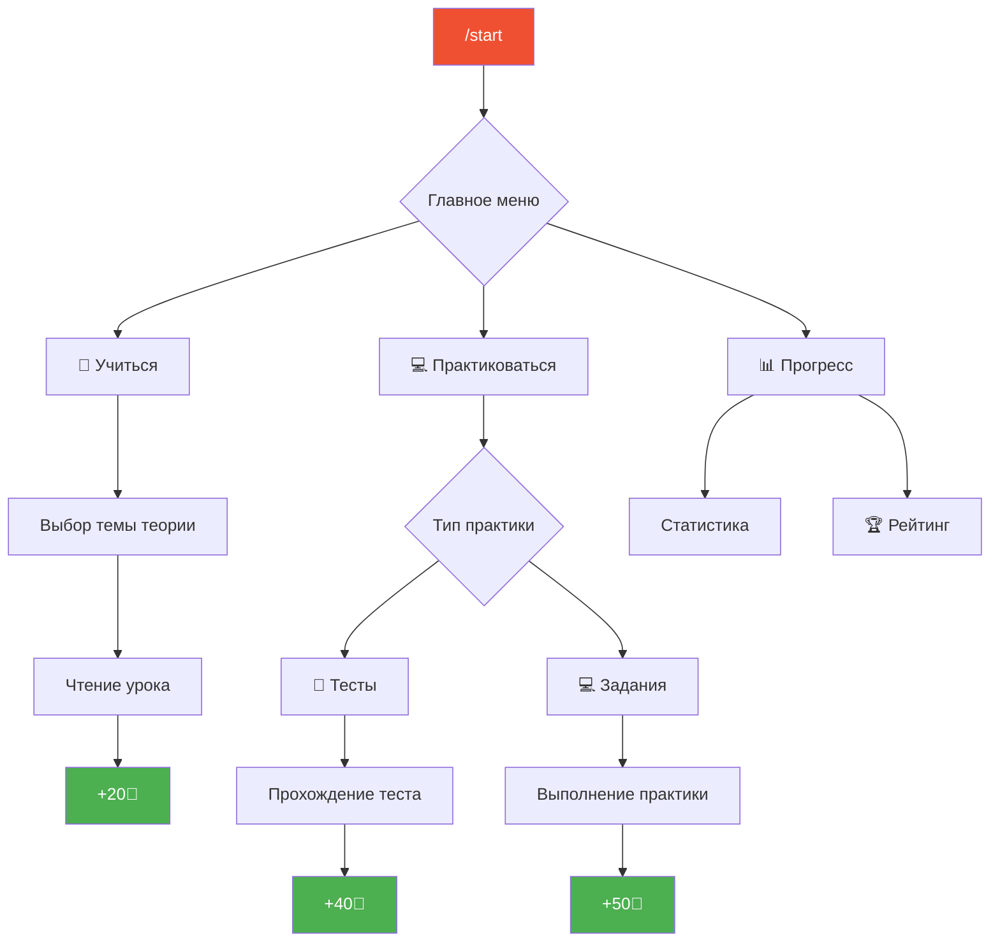

<div align="center">

<!-- Animated SVG Header -->


<!-- Badges -->
<p>
  
  
  
  
</p>


<!-- Quick Stats -->
<table>
  <tr>
    <td align="center"><strong>📚</strong></td>
    <td align="center"><strong>📝</strong></td>
    <td align="center"><strong>💻</strong></td>
    <td align="center"><strong>🎨</strong></td>
  </tr>
  <tr>
    <td align="center">7 уроков теории</td>
    <td align="center">7 тестов</td>
    <td align="center">6 практик</td>
    <td align="center">15 стикеров</td>
  </tr>
</table>

</div>

---

## 🚀 О проекте

**Git Edu Bot** — это образовательный Telegram-бот, разработанный для интерактивного изучения системы контроля версий Git. Бот предоставляет структурированный курс, включающий теоретические материалы, тесты для проверки знаний и практические задания.

> 🎮 **Геймификация обучения:** Теория (+20🔆) → Тесты (+40🔆) → Практика (+50🔆) → Награды (🎨 Стикеры)

---

## ✨ Ключевые особенности

<table>
<tr>
<td width="50%">

### 📚 Структурированное обучение
- **7 теоретических модулей** с пошаговым изложением
- Логичная последовательность от основ к продвинутым темам
- Поддержка форматирования HTML для удобного чтения

</td>
<td width="50%">

### 📝 Интерактивные тесты
- **7 тестов** по каждой теме курса
- 4 варианта ответа с мгновенной проверкой
- Автоматический подсчёт результатов в процентах

</td>
</tr>
<tr>
<td width="50%">

### 💻 Практические задания
- **6 практических упражнений** с реальными сценариями
- Пошаговые инструкции для выполнения
- Закрепление теоретических знаний на практике

</td>
<td width="50%">

### 🏆 Система мотивации
- **Очки (🔆)** за каждое выполненное задание
- **Ежедневный рейтинг** пользователей
- **Магазин стикеров** для траты заработанных очков

</td>
</tr>
</table>

---

## 📖 Программа курса

### 📚 Модули теории

| # | Тема | Описание |
|:-:|------|----------|
| 1️⃣ | **Введение в Git** | Что такое Git, зачем он нужен, основные концепции |
| 2️⃣ | **Установка и настройка** | Установка Git на различные ОС, первичная конфигурация |
| 3️⃣ | **Основы работы** | `init`, `add`, `commit`, `status`, `log` — базовые команды |
| 4️⃣ | **Ветвление и слияние** | Создание веток, `merge`, разрешение конфликтов |
| 5️⃣ | **Удалённые репозитории** | `clone`, `push`, `pull`, `fetch`, работа с GitHub |
| 6️⃣ | **Отмена изменений** | `reset`, `revert`, `checkout`, восстановление данных |
| 7️⃣ | **Продвинутые возможности** | `rebase`, `stash`, `cherry-pick`, теги |

---

## 🎮 Система геймификации

### 💰 Система очков

| Активность | Награда |
|:----------:|:-------:|
| 📖 Теория | **+20** 🔆 |
| 📝 Тест | **+40** 🔆 |
| 💻 Практика | **+50** 🔆 |

### 🏪 Магазин стикеров

- **15 уникальных стикеров** на тему Git
- Разная стоимость: от 30 до 60 🔆
- Купленные стикеры отправляются пользователю
- **Бонус**: при покупке всех стикеров — эксклюзивный стикерпак!

### 📊 Рейтинг

- Ежедневное соревнование между пользователями
- Автоматический сброс дневных очков в полночь (MSK)
- Пагинация для удобного просмотра лидерборда
- Визуальное выделение: 🥇 🥈 🥉 для топ-3

---
## 📱 Использование бота

<div align="center">



</div>

### Команды бота

| Команда | Описание |
|---------|----------|
| `/start` | Запуск бота и главное меню |
| `/shop` | Открыть магазин стикеров |

---

## 🎁 Финальный подарок

После прохождения **всех 7 уроков и тестов** пользователь получает:

- 🎉 **Поздравительное сообщение** с итоговой оценкой
- 📊 **Средний балл** по всем тестам
- 📎 **Git-шпаргалку** — изображение с основными командами
- 🔗 **Полезные ссылки** для дальнейшего изучения:
  - W3Schools Git Tutorial
  - Git How To
  - GeeksforGeeks Git Exercises
  - Learn Git Branching
  - Официальная документация Git и GitHub
---

## 🏗️ Архитектура проекта

```
git-edu-bot/
├── 📁 src/
│   ├── 📁 bot/
│   │   ├── 📁 handlers/          # Обработчики сообщений
│   │   │   ├── 📁 theories/      # 7 модулей теории
│   │   │   ├── 📁 tests/         # 7 тестов
│   │   │   ├── 📁 practices/     # 6 практик
│   │   │   ├── commands.py       # /start, /shop
│   │   │   ├── menu.py           # Навигация
│   │   │   ├── progress.py       # Прогресс пользователя
│   │   │   ├── rating.py         # Система рейтинга
│   │   │   ├── shop.py           # Магазин стикеров
│   │   │   └── final_gift.py     # Финальный подарок
│   │   ├── 📁 keyboards/         # Inline-клавиатуры
│   │   ├── 📁 middlewares/       # Middleware (обновление сообщений)
│   │   ├── 📁 states/            # FSM-состояния
│   │   └── 📁 utils/             # Настройки, декораторы
│   ├── 📁 db/
│   │   ├── database.py           # MongoDB операции
│   │   ├── scheduler.py          # APScheduler для сброса очков
│   │   └── config.py             # Конфигурация БД
│   └── main.py                   # Точка входа
├── 📁 data/
│   ├── 📁 theories/              # JSON с теорией (8 файлов)
│   ├── 📁 tests/                 # JSON с тестами (8 файлов)
│   ├── 📁 practices/             # JSON с практиками (6 файлов)
│   ├── 📁 shop/                  # Изображения стикеров
│   │   ├── 📁 locked/            # Заблокированные превью
│   │   ├── 📁 unlocked/          # Разблокированные превью
│   │   └── 📁 stickers/          # WebP стикеры
│   └── 📁 final_gift/            # Шпаргалка по Git
├── docker-compose.yml            # Docker конфигурация
├── requirements.txt              # Python зависимости
└── .env                          # Переменные окружения
```

---

## 🛠️ Технологии

<div align="center">

| Технология | Описание |
|:----------:|----------|
|  | **Python 3.11+** — основной язык разработки |
|  | **Aiogram 3.x** — асинхронный фреймворк для Telegram Bot API |
|  | **MongoDB** — NoSQL база данных для хранения прогресса |
|  | **Docker** — контейнеризация приложения |

</div>

### 📦 Основные зависимости

```txt
aiogram>=3.0.0          # Telegram Bot Framework
motor>=3.0.0            # Async MongoDB driver
python-dotenv>=1.0.0    # Environment variables
apscheduler>=3.10.0     # Task scheduling
```

---

## 🚀 Быстрый старт

### Предварительные требования

- Docker и Docker Compose
- Telegram Bot Token (получить у [@BotFather](https://t.me/BotFather))

### 📥 Установка и запуск

```bash
# 1. Клонируйте репозиторий
git clone https://github.com/averbusem/git-edu-bot.git
cd git-edu-bot

# 2. Создайте файл .env
echo "BOT_TOKEN=your_telegram_bot_token" > .env

# 3. Запустите проект
docker compose up --build -d
```

Эта команда запустит:
- 🗄️ **mongoGitEdu** — контейнер с MongoDB (порт `27017`)
- 🤖 **bot** — контейнер с Telegram-ботом

### ⚙️ Конфигурация `.env`

```env
BOT_TOKEN=your_telegram_bot_token
```


<!-- Animated Footer -->


